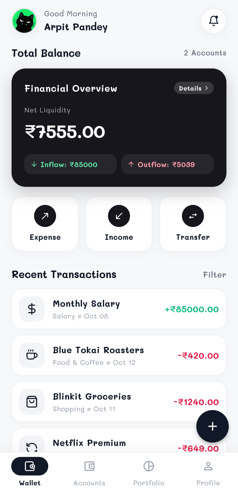
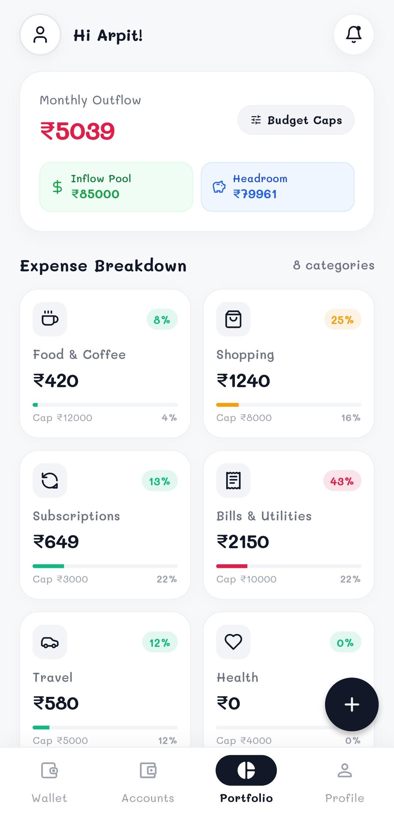
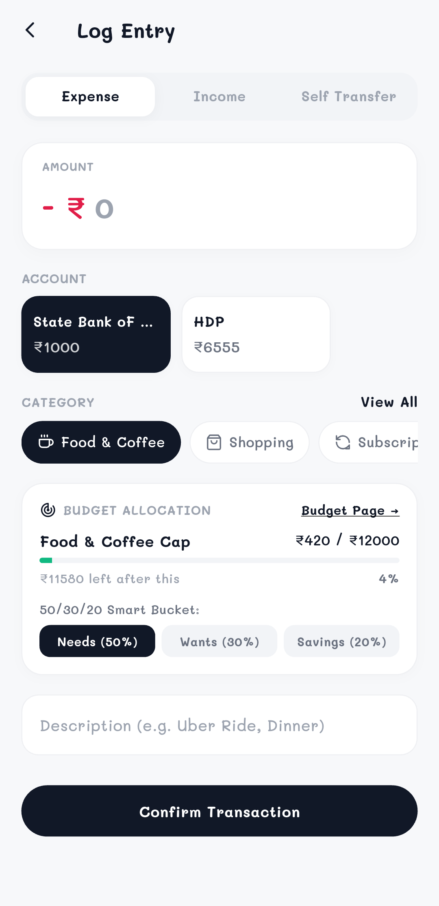
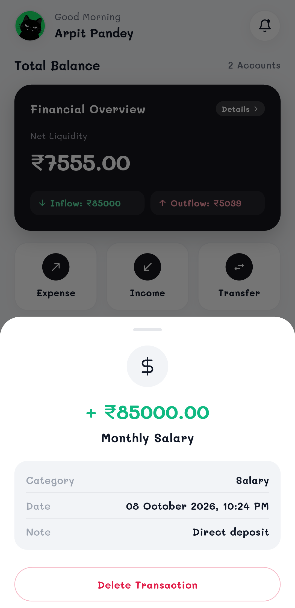
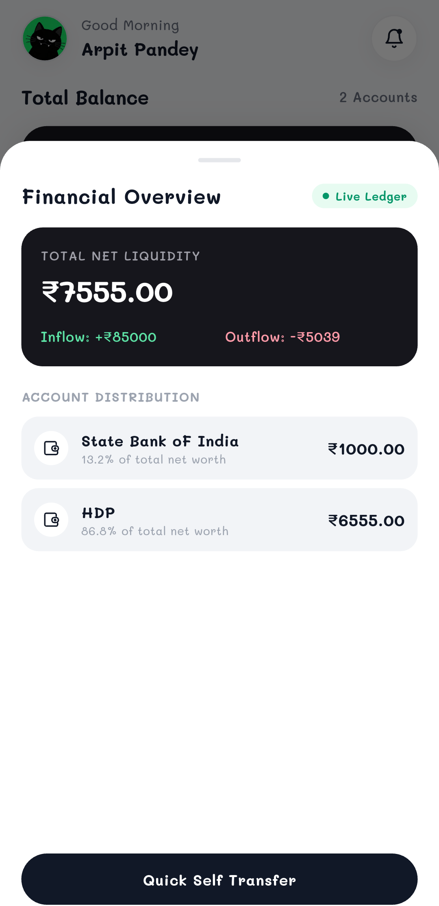
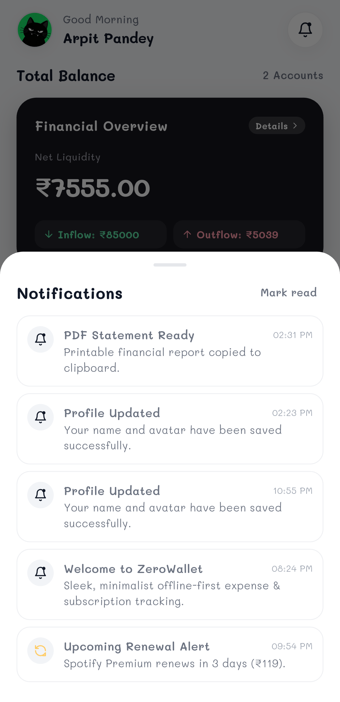
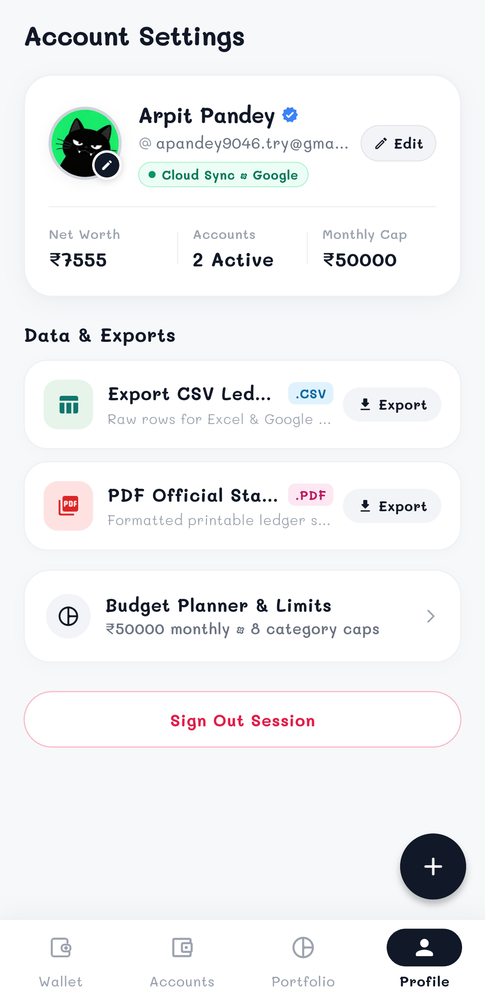
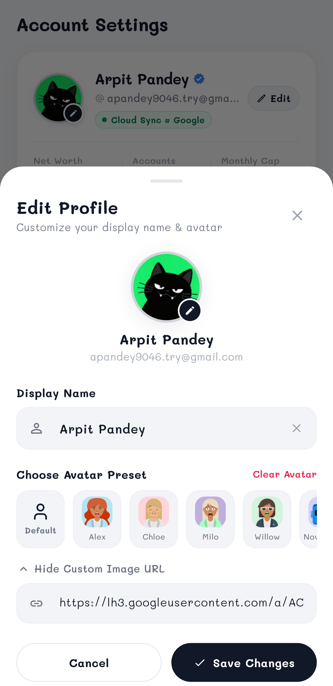

# Wallet

Personal finance and expense tracking app built with Flutter and Firebase.

## Screenshots

| Home & Balance | Expense Breakdown | Add Transaction | Transaction Details |
|:---:|:---:|:---:|:---:|
|  |  |  |  |

| Account Distribution | Notifications | Settings & Exports | Edit Profile |
|:---:|:---:|:---:|:---:|
|  |  |  |  |

## Features

- **Multi-Account Tracking**: Manage balances across multiple bank accounts and cash wallets with self-transfer support.
- **Expense & Inflow Analytics**: Track monthly outflow, inflow pool, category-wise spending breakdown, and budget caps.
- **50/30/20 Budgeting**: Allocate expenses into Needs, Wants, and Savings buckets during entry.
- **Subscriptions Manager**: Track recurring payments and receive upcoming renewal alerts.
- **Data Export**: Export transactions to CSV and generate printable PDF financial statements.
- **Authentication & Sync**: Google Sign-In with Cloud Firestore sync, along with offline guest mode.
- **Profile Customization**: Avatar presets, custom image URL support, and display name management.

## Tech Stack

- **Framework**: Flutter 3.x / Dart 3.x
- **State Management**: Provider
- **Backend & Auth**: Firebase Auth, Cloud Firestore, Google Sign-In
- **Local Storage**: SharedPreferences
- **Reporting**: `pdf`, `printing`

## Getting Started

### Prerequisites
- Flutter SDK (v3.24+)
- Dart SDK (v3.5+)

### Installation

```bash
git clone https://github.com/apandey-dev/wallet.git
cd wallet
flutter pub get
```

### Firebase Setup (Optional)
To use cloud sync with your own Firebase project:
```bash
dart pub global activate flutterfire_cli
flutterfire configure
```
*Note: The app works completely offline in Guest Mode without Firebase.*

### Run

```bash
flutter run
```

## License

This project is licensed under the MIT License - see the [LICENSE](LICENSE) file for details.
